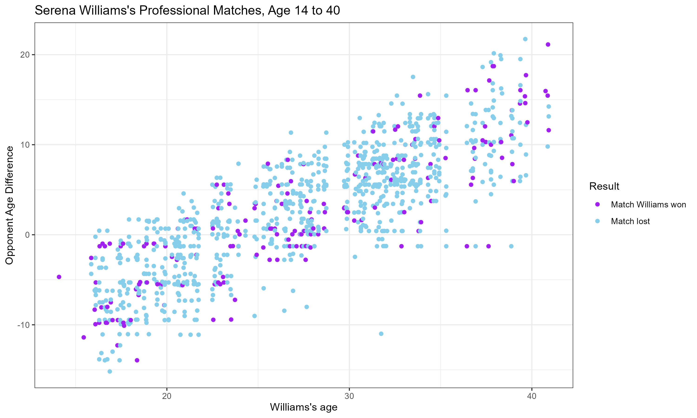

---
format:
  html:
    embed-resources: true
---

## Homework Assignment 2: Reproducing Serena Williams’s Plot

This assignment was continuing from homework 1 with the goal of reproducing a graph of Serena Williams's matches based on her age and opponent's age. Here, we take a javascript file available online, do data cleaning, and plot the graph, shown below.

The original plot and article from The New York Times can be found [here](https://www.nytimes.com/interactive/2022/08/28/sports/tennis/serena-age-opponents.html).

